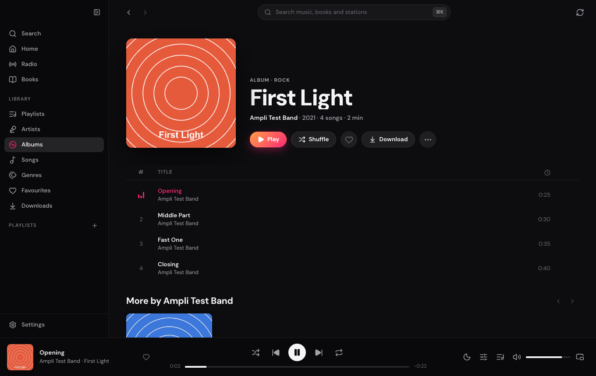
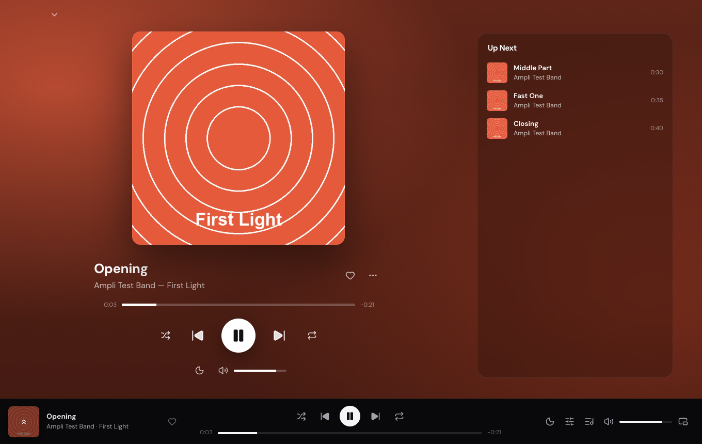
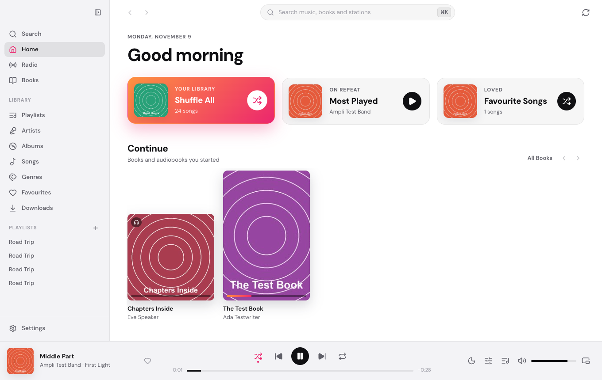
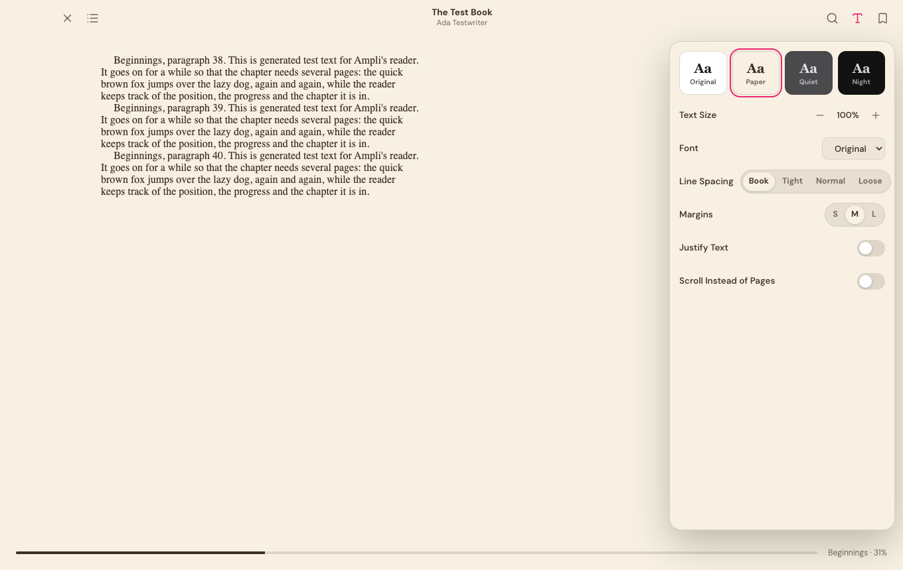

# Ampli for Desktop

A free player for your own server, on macOS, Windows and Linux. It plays:

- **Music** from Jellyfin, Navidrome and other (Open)Subsonic servers.
- **YouTube Music** through your own [Amplicon](https://github.com/eliasthecactus/ampli-con) server.
- **Audiobooks and ebooks** from Audiobookshelf and Jellyfin.
- **Live radio** from 34 countries.

It has the same features as [Ampli for iPhone, iPad, Mac and Apple TV](https://github.com/eliasthecactus/ampli-ios), with a design made for big windows, mouse and keyboard. No ads, no account, no tracking.

Built with [Tauri 2](https://tauri.app): a small Rust core plus a React interface in the system's web view.

| | |
|---|---|
|  |  |
|  |  |

## Install

Download the installer for your system from the [latest release](https://github.com/eliasthecactus/ampli-desktop/releases/latest).

| System | File | |
|---|---|---|
| macOS 11+ (Apple silicon and Intel) | `Ampli_<version>_universal.dmg` | Open it and drag Ampli to Applications. |
| Windows 10/11 | `Ampli_<version>_x64-setup.exe` (or the `.msi`) | Run it; no admin rights needed for the `.exe`. |
| Debian, Ubuntu, Mint | `Ampli_<version>_amd64.deb` | `sudo apt install ./Ampli_*_amd64.deb` |
| Fedora, openSUSE | `Ampli-<version>-1.x86_64.rpm` | `sudo dnf install ./Ampli-*.rpm` |
| Any other Linux | `Ampli_<version>_amd64.AppImage` | `chmod +x Ampli_*.AppImage && ./Ampli_*.AppImage` |

The installers aren't signed with a paid certificate yet, so the system asks once before the first start:

- **macOS** says Ampli "can't be opened" or "is damaged". Right-click Ampli in Applications → **Open** → **Open**. If that isn't offered, run `xattr -cr /Applications/Ampli.app` in Terminal, then open it again.
- **Windows** SmartScreen says "Windows protected your PC". Click **More info** → **Run anyway**.
- **Linux**: the `.deb` and `.rpm` pull in what they need. With the AppImage, playing AAC and MP3 streams needs the GStreamer plugins: `sudo apt install gstreamer1.0-plugins-good gstreamer1.0-plugins-bad gstreamer1.0-libav` (Debian/Ubuntu) or `sudo dnf install gstreamer1-plugins-good gstreamer1-plugins-bad-free gstreamer1-libav` (Fedora). Saving sign-ins in the keychain needs a Secret Service (GNOME Keyring or KWallet); without one, Ampli keeps them in its own settings instead.

### Getting started

1. Open Ampli and click **Connect a Server**, or **Just Listen to Radio** if you only want radio.
2. Pick the kind of server and enter its address (`music.example.com`, or `192.168.1.10:4533` at home), your username and password.
3. Ampli loads your library. That takes a moment the first time; afterwards it syncs in the background. Add more servers any time under **Settings › Servers**, and choose there which libraries to sync.

Tips:

- **⌘K / Ctrl+K** searches everything.
- **Space** plays and pauses. **⌥⌘M / Ctrl+Alt+M** opens the mini player.
- Right-click songs, albums and playlists for Play Next, Add to Playlist, Download and more.
- A server with a self-signed certificate asks once whether to trust it, showing the certificate's fingerprint.
- An address with plain `http://` works for servers at home. For anything else, turn on **Allow Unencrypted Connection** for that server only if you know why.

### Updating

Download the new version from the releases page and install it over the old one. Your servers, settings and downloads stay.

## Features

### Browsing and search

- **Home**: Shuffle All, Most Played, Favourite Songs, Continue (books in progress), Recently Played, Recently Added, Discover, Playlists, and your Amplicon "For You" rows and favourite stations.
- **Library**: Playlists, Artists, Albums (sort by name, artist, year or date added), Songs, Genres, Favourites and Downloads. Every list has a filter, and long lists are virtualized.
- **Search**: ⌘K / Ctrl+K opens a palette over music, books and stations. It works offline and ignores accents: "zuerich" finds "Zürich", "bjork" finds "Björk". With Amplicon there's a Library | Amplicon picker.
- **Content switches**: music, books, audiobooks and radio can each be turned off. Radio alone needs no server ("Just Listen to Radio").

### Music

- **Player bar**: shuffle, repeat (all/one), sleep timer (incl. end of song), volume, queue and mini player.
- **Full-screen Now Playing**: tinted in the cover's colour, with Up Next.
- **Queue**: drag to reorder, Play Next, Add to Queue, Clear.
- **Gapless-style playback**: the next song is loaded ahead in a second audio element.
- **Plays reported** to the server (Now Playing, scrobbles, play counts), plus a local history for Recently Played.
- **Media keys** and the system's Now Playing (Media Session API).

### Playlists and favourites

- **Playlists**: create, rename and delete them, add songs and albums, remove songs, and drag to reorder. Works on Jellyfin (entry ids), Navidrome/Subsonic and Amplicon. "Add to Playlist" only lists playlists of the song's own server.
- **Favourites** for songs, albums and artists, synced with the server.

### Sound

- **10-band equalizer** (Web Audio biquads) with 15 presets and a preamp. It applies to all music or to one server or library; songs remember where they came from.
- **Volume normalization** from ReplayGain or Jellyfin's normalization gain.

### Audiobooks

- One or many files per book, with chapters.
- 15/30 s skips and 0.5×–3× speed with the pitch kept.
- Sleep timer, incl. end of chapter.
- Progress synced with the server (Audiobookshelf progress API, Jellyfin playback positions).
- Downloads for offline listening.

### Reader

- **EPUB** (epub.js, with book scripts switched off), **PDF** (pdf.js) and **CBZ** comics with a right-to-left mode for manga.
- Themes Original, Paper, Quiet and Night, plus fonts, text size, line spacing, margins, justification, and pages or scrolling.
- Bookmarks, highlights in five colours with notes, search in the book, table of contents and a progress slider.
- The position is saved locally and synced: Audiobookshelf ebook progress, Jellyfin played percentage.

### Radio

- 1000+ stations from 34 countries, shipped with the app (`src/data/radio-stations.json`, the same list as the iOS app).
- Shelves by language region (Switzerland) or genre, plus favourites and recently played.
- Song titles from ICY metadata, read by the Rust proxy, and ID3 tags in HLS streams.
- Next/previous station, sleep timer, and reconnects when the network comes back.

### Amplicon

- For You, and search over YouTube Music.
- Album, playlist and artist pages; songs play through Amplicon's signed stream links.
- Edit the connected account's playlists.
- "Add to Server" with the server's profiles, a tag review before downloads, and live job progress with cancel, retry and remove.

### Offline

- Download songs, albums, artists, playlists, audiobooks and ebooks.
- Offline mode, and auto-download of favourites.

### Servers

- Several servers at once, and you choose which libraries to sync on each.
- **Plain http** only for servers you allow it for. It's on by default for addresses at home.
- **Self-signed certificates** are trusted per server, by SHA-256 pin.
- Sign-in tokens are kept in the system keychain: macOS Keychain, Windows Credential Manager, or Secret Service on Linux.

### Desktop

- Mini player that stays on top (⌥⌘M).
- Keyboard shortcuts: Space, ⌘←/→, ⌘↑/↓, ⌘K, ⌘[ / ⌘], ⌘P, ⌘, and the mouse back/forward buttons.
- Light and dark themes (or follow the system) and five accent colours.

Not here, because they're Apple-only in the iOS app: iCloud sync, widgets, Siri/Shortcuts and Apple TV. Ampli for Desktop is in English only for now.

## How it's built

| | |
|---|---|
| `src-tauri/src/proxy.rs` | A local HTTP server on `127.0.0.1` with a random token in every path. The web view talks to your servers through it (more below). It also serves downloaded files with range requests. |
| `src-tauri/src/tls.rs` | HTTP clients: the usual certificate checks, or a pinned SHA-256 per server; also reads a certificate's fingerprint for the "Trust this certificate?" dialog. |
| `src-tauri/src/lib.rs` | Commands: downloads (with progress events and cancel), keychain, certificate probe, mini player window. |
| `src/lib/servers` | `JellyfinClient`, `SubsonicClient`, `AudiobookshelfClient`, `AmpliconClient`: ports of the iOS clients, with the same quirks handled (Navidrome's `estimateContentLength`, Jellyfin's header encoding, Audiobookshelf token refresh, Amplicon's HMAC-signed stream links). |
| `src/lib/library.ts` | Sync into IndexedDB (Dexie) and an in-memory index, so browsing and search are instant and work offline. |
| `src/lib/engine.ts` | Web Audio graph: per-element gain (normalization) → 10 biquads → preamp → volume. One source plays at a time. |
| `src/lib/player.ts`, `audiobook.ts`, `radio.ts` | The three players. |
| `src/components/Reader.tsx` | EPUB, PDF and CBZ reader. |
| `src/views` | Pages. `src/styles/app.css` is the whole design system. |

The proxy does four jobs:

- It answers with CORS headers, so streams can go through the Web Audio equalizer.
- It checks pinned certificates.
- It makes http servers count as a local origin, so streams aren't blocked as mixed content.
- It strips ICY metadata out of radio streams and keeps the titles.

Songs play from a download if there is one, otherwise they stream. Jellyfin streams through `/Audio/{id}/universal`: direct play when the web view can, MP3 otherwise. Subsonic streams through `stream.view` (`format=raw`, or MP3 for formats the web view can't play).

## Development

You need Node 20+, Rust (stable), and the [Tauri prerequisites](https://tauri.app/start/prerequisites/) for your system. On Linux that means `libwebkit2gtk-4.1-dev`, `libdbus-1-dev`, and GStreamer plugins for AAC/MP3/FLAC playback (`gstreamer1.0-plugins-good`, `-bad`, `gstreamer1.0-libav`).

```sh
npm install
npm run app:dev       # the desktop app with hot reload
npm run app:build     # installers in src-tauri/target/release/bundle
```

`npm run dev` runs the interface in a normal browser. A small stand-in for the Rust proxy in `vite.config.ts` lets it talk to real servers. Downloads, the keychain and the mini player need the desktop app.

### Tests

```sh
npm test                          # TypeScript: hashes, search, radio titles, server URLs, Amplicon signatures
(cd src-tauri && cargo test --lib)  # Rust: proxy, ICY stripping, certificate pinning
```

The certificate test uses the self-signed server from the iOS repo's test servers (`scripts/test-servers.sh up` in ampli-ios). It skips itself when that server isn't running. The same test servers (Jellyfin, Navidrome and Audiobookshelf with generated media) work for trying the app by hand. Sign in as `ampli` with the password `test&pass1`.

### Releases

1. Set the version in `src-tauri/tauri.conf.json`, `src-tauri/Cargo.toml` and `package.json`.
2. Tag it: `git tag v1.2.3 && git push origin v1.2.3`.

`.github/workflows/release.yml` then builds:

- a universal macOS `.dmg`,
- Windows `.exe` and `.msi`,
- Linux `.deb`, `.rpm` and `.AppImage`.

It publishes them as a GitHub release with generated notes. `.github/workflows/ci.yml` runs the tests on every push and pull request.

To sign the macOS and Windows builds, add the signing secrets described in Tauri's [distribution guides](https://tauri.app/distribute/) to the release workflow.

## License

[MIT](LICENSE) © 2026 Elias Frehner
